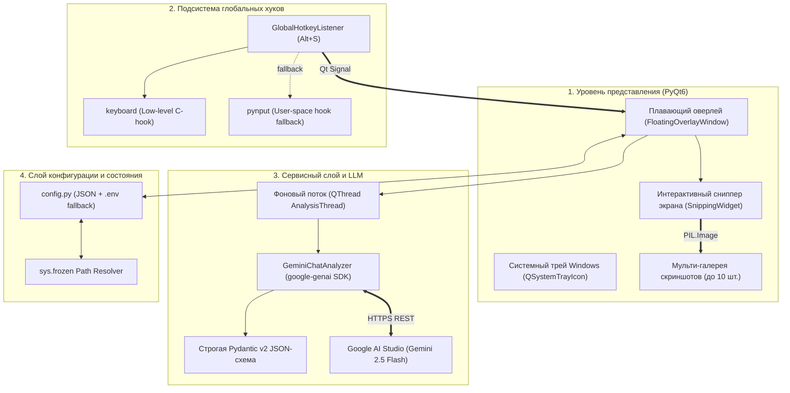

# 🛠️ Техническая спецификация и архитектура проекта VibeSense AI

## 1. Общее описание системы

**VibeSense AI** — это легковесное десктопное приложение-оверлей для операционной системы Windows, предназначенное для анализа невербальных сигналов, психологической динамики, эмоционального окраса и негласных правил цифровых переписок.

Система работает по принципу визуального ассистента: пользователь захватывает область экрана с фрагментом чата (до 10 последовательных кадров), после чего данные напрямую отправляются в мультимодальную языковую модель **Google Gemini 2.5 Flash**. Модель «чувствует» тональность беседы, вычисляет числовые метрики накала и дистанции, а также генерирует калиброванные варианты ответов с возможностью мгновенного копирования в буфер обмена.

---

## 2. Архитектура решения

Архитектура VibeSense AI спроектирована по модульному принципу и разделена на 4 ключевых уровня:

---

## 3. Технологический стек

| Компонент | Технология / Библиотека | Назначение |
|---|---|---|
| **Ядро и среда** | Python 3.9+ / Windows x64 | Основной язык реализации |
| **Графический интерфейс** | `PyQt6` (Qt 6.10) | Кастомные фреймлесс-окна, рендеринг, системный трей, анимации |
| **Захват экрана** | `QScreen.grabWindow` + `QBuffer` | Пиксельный снимок виртуального десктопа Windows без задержек |
| **Обработка графики** | `Pillow (PIL)` | Масштабирование, конвертация цветовых профилей (RGBA → RGB), буферизация JPEG |
| **Искусственный интеллект** | `google-genai` (Gemini Flash) | Мультимодальный анализ визуального контекста чатов |
| **Типизация и схема данных** | `Pydantic v2` | Строгая валидация и structured outputs в формате JSON |
| **Глобальные горячие клавиши** | `keyboard` + `pynput` | Перехват `Alt + S` в фоне поверх полноэкранных игр и любых окон |
| **Конфигурация** | `python-dotenv` + `json` | Чтение параметров, сохранение координат окна и API-ключа |
| **Компиляция в бинарник** | `PyInstaller 6.19` | Сборка в единый исполняемый файл `.exe` (PE32+) |

---

## 4. Детальное описание ключевых модулей

### 4.1. Модуль захвата экрана (`snipper.py`)
* Реализован на базе `QWidget` с флагами `FramelessWindowHint | WindowStaysOnTopHint | Tool`.
* **Поддержка High-DPI (Retina / 4K):** логические координаты селектора автоматически нормализуются через `devicePixelRatioF()` (для масштабов 125%, 150%, 200%), предотвращая смещение и размытие кропа.
* **Безопасная конвертация в памяти:** скриншот сохраняется через `QBuffer` (нативный `QIODevice`), исключая запись временных файлов на диск.
* Поддерживает отмену по `Esc` или клику ПКМ с автоматическим возвратом главного окна.

### 4.2. Плавающий оверлей (`overlay_window.py`)
* **Абсолютное предотвращение горизонтального сдвига (`FitScrollArea`):** кастомный подкласс `QScrollArea`, который принудительно синхронизирует ширину дочернего контейнера с шириной области просмотра (`viewport().width()`).
* **Мульти-галерея (до 10 скриншотов):** позволяет пользователю «нарезать» длинный диалог при прокрутке. Каждый скриншот снабжен миниатюрой, бейджем хронологии (`#1`...`#10`) и кнопкой точечного удаления.
* **Сетка целей ответа:** адаптивная 2-колоночная сетка (`QGridLayout`) с быстрыми пресетами («Влиться в беседу», «Сбить накал», «Сторговаться», «Флирт», «Отказ», «По делу») + поле ввода произвольной пользовательской цели с валидацией в реальном времени.
* **Асинхронность:** тяжелый сетевой запрос в Gemini вынесен в отдельный рабочий поток `AnalysisThread (QThread)`, сохраняя интерфейс отзывчивым (60 FPS) без фризов.

### 4.3. Сервис Gemini Flash (`gemini_service.py`)
* Использует официальный SDK нового поколения `google-genai`.
* Встроенный защищенный API-ключ в конфигурации («Zero-Config» запуск для конечного пользователя без необходимости настройки).
* **Поддержка двух моделей и умный переключатель в шапке:**
  * `⚡ 2.5 Flash` (`gemini-2.5-flash`) — основная мощная модель по умолчанию;
  * `🚀 3.5 Flash Lite` (`gemini-3.5-flash-lite`) — сверхбыстрая резервная модель.
* **Автоматический отказоустойчивый Fallback (Smart Quota Shield):** при исчерпании лимитов запросов (HTTP 429 / Quota Exceeded / Rate Limit на модели 2.5 Flash) сервис автоматически, без прерывания пользовательской сессии, перезапускает анализ на модели `gemini-3.5-flash-lite`, добавляет статусное предупреждение в карточку результатов и бесшовно переключает селектор в интерфейсе.
* В `contents` передается массив всех накопленных скриншотов диалога в байтовом виде (`image/jpeg`) с указанием хронологического порядка.
* **Structured Output (Гарантированный JSON):** параметр `response_schema=ChatAnalysisResult` обязывает модель вернуть строго валидный JSON, соответствующий Pydantic-схеме:
  * `summary` — краткая суть происходящего;
  * `atmosphere` — вайб, накал (1–10), формальность (1–10), дистанция, темп, негласные правила;
  * `tactical_advice` — список из 2–4 практических рекомендаций;
  * `draft_critique` — психологический разбор пользовательского черновика;
  * `adapted_replies` — 3–4 варианта готовых реплик с обоснованием психологического эффекта.

### 4.4. Отказоустойчивый перехватчик хоткеев (`hotkey_listener.py`)
* Реализует двухъядерный механизм: сначала пробует низкоуровневый хук через библиотеку `keyboard`, а при нехватке прав UAC автоматически переключается на `pynput.keyboard.GlobalHotKeys`.
* Для исключения взаимоблокировок (deadlock) используется реентрантная блокировка `threading.RLock()`.
* Сигналы о нажатии клавиш передаются в главный GUI-поток через потокобезопасные очереди событий Qt (`pyqtSignal`).

---

## 5. Почему Vision (мультимодальный скриншот), а не DOM-парсер / API

1. **Универсальность:** приложению безразлично, где ведется переписка — нативный клиент Telegram, Discord, десктопный WhatsApp, вкладка FunPay в браузере или приватный чат игры.
2. **Безопасность аккаунтов:** парсинг через юзерботов или перехват токенов в Telegram/WhatsApp приводит к мгновенной блокировке аккаунта за спам/автоматизацию. Скриншот со стороны ОС абсолютно невидим для антифрод-систем мессенджеров.
3. **Невербальный контекст:** скриншот передает визуальное расположение реплик (кто кому пишет), таймстампы, паузы, стикеры, эмодзи и оформление, чего лишен сырой текст.

---

## 6. Сборка в Standalone Executable

Исполняемый файл собран при помощи утилиты **PyInstaller** со следующими параметрами:
* `--onefile` — сборка всех библиотек, интерпретатора Python, DLL-библиотек Qt и зависимостей в единый файл;
* `--noconsole` — скрытие черного окна терминала для бесшовного UX;
* `--icon` — встраивание векторного мультииконного формата `.ico`;
* Полноценная поддержка портативности через `sys.frozen`: файл конфигурации `config.json` и `.env` автоматически создаются рядом с `.exe` файлом, а не в системных временных каталогах.

